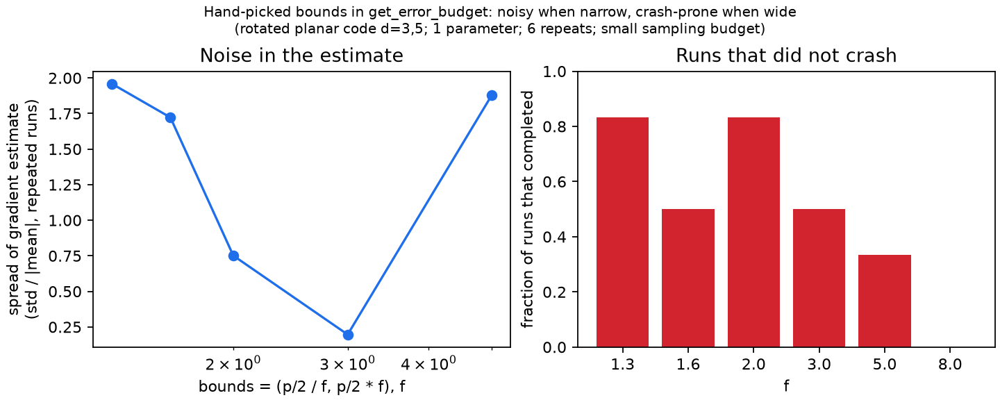

# deltakit-bounds-benchmark

A small, reproducible benchmark for [Deltakit issue #216](https://github.com/Deltakit/deltakit/issues/216)
("automatically find bounds in error-budgeting"). It measures how the choice of
exploration bounds affects the gradient of 1/Λ computed by
`deltakit_explorer.analysis.error_budget.inverse_lambda_gradient_at`.



## Setup
Rotated planar code, distances 3 and 5 (rounds 2 and 4), one parameter (uniform depolarising noise after
Cliffords), gradient at p/2 = 1e-3, `C_OPTIMAL` discretisation with 6 points, degree-3 fit. Bounds are
(p/2 / f, p/2 * f) for f in 1.3 ... 8. Six repeats per width. Sampling: at most 200,000 shots, target
relative standard error 5 %, at least 20 failures.

## Result (small sample, indicative only)
| f | completed runs | relative spread (std over mean) |
|---|---|---|
| 1.3 | 5/6 | 1.96 |
| 1.6 | 3/6 | 1.72 |
| 2.0 | 5/6 | 0.75 |
| 3.0 | 3/6 | 0.20 |
| 5.0 | 2/6 | 1.88 |
| 8.0 | 0/6 | n/a |

Narrow bounds give a noisy gradient (sometimes the wrong sign). Wide bounds make runs fail in the Λ fit
(`LinAlgError` / `ValueError`). A narrow sweet spot exists around f ~ 3.

## Limitations
Only 2-5 successful runs per width; a deliberately cheap shot budget (some failures may be caused by it);
one noise parameter; two code sizes; Deltakit explorer 0.9.4. The next step is to repeat with larger budgets
and to compare against an automatic bounds finder.

## Reproduce
```bash
python -m venv venv && source venv/bin/activate   # Windows Git Bash: source venv/Scripts/activate
pip install -r requirements.txt
TQDM_DISABLE=1 python bench_bounds.py 6 C_OPTIMAL   # about 5 minutes; writes bounds_C_OPTIMAL.jsonl
python plot_bounds.py
```
(Both scripts read and write in the current folder.)

See [RESULTS_V2.md](RESULTS_V2.md) for the v2 results: measurement noise, d=3, 5, 7 and repeat statistics.
